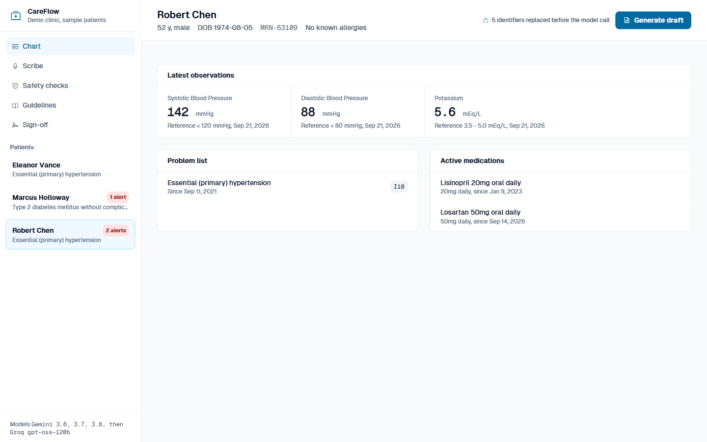
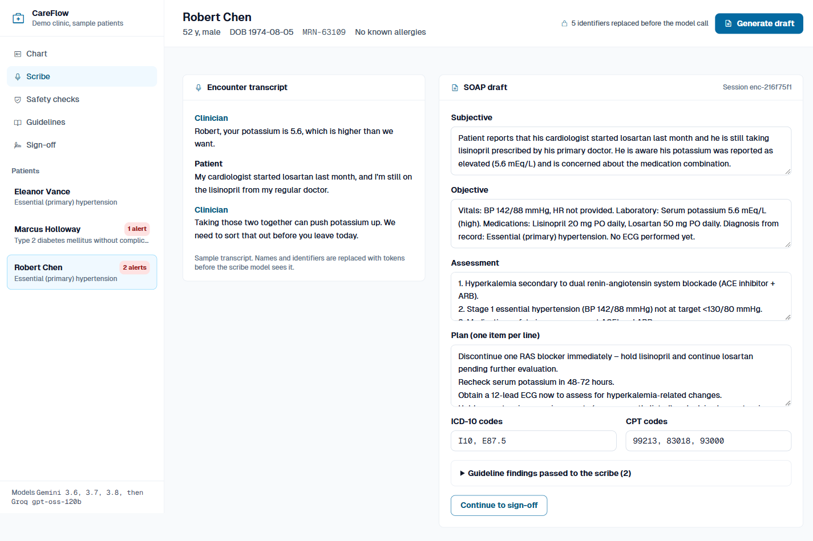
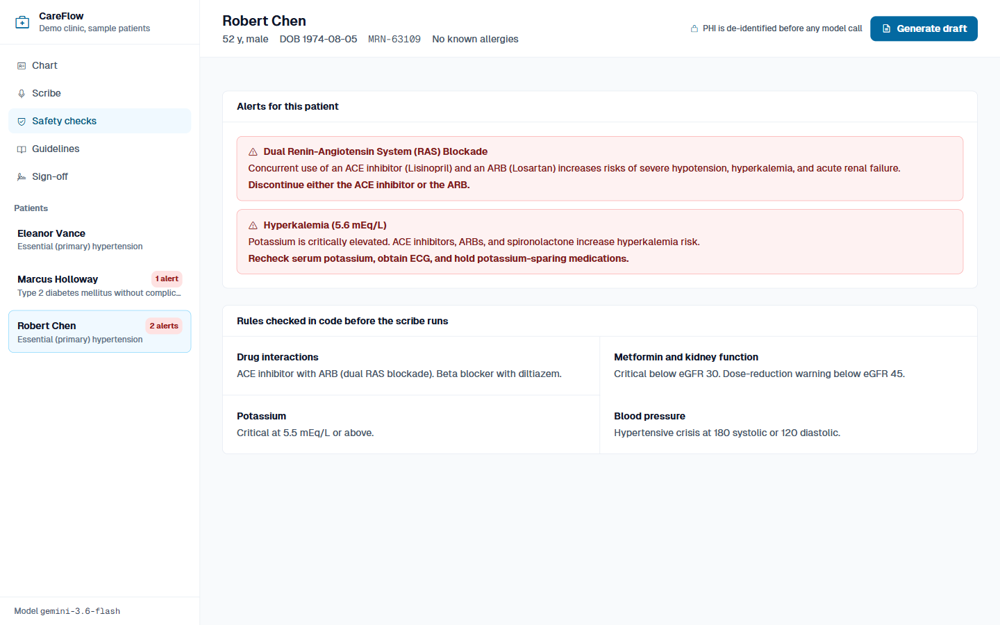
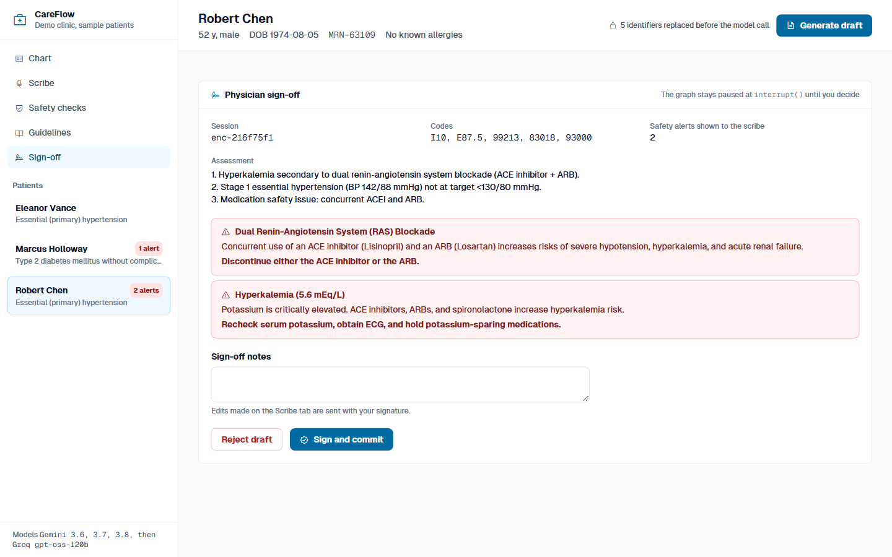

# CareFlow Clinical Agent (EHR & Clinical Decision Support Platform)

[](https://github.com/varadganjoo/careflow-clinical-agent/actions/workflows/ci.yml)
[](https://www.python.org/downloads/)
[](https://modelcontextprotocol.io/)
[](docs/ARCHITECTURE.md)
[](LICENSE)

A clinical decision support and documentation demo built with **Gemini** (3.6, 3.7 and 3.8 Flash as a fallback chain, then Groq as a backup), a **Model Context Protocol (MCP)** server, and a **LangGraph state machine** with a **Human-in-the-Loop (HITL)** physician sign-off.

It drafts SOAP notes from an encounter transcript and FHIR-shaped patient data, runs deterministic safety checks (drug interactions, renal contraindications, critical labs) before the model is called, de-identifies patient identifiers before any model call, and pauses the graph until a physician approves, edits, or rejects the draft.

**Live demo:** https://careflow-clinical-agent.vercel.app (sample patients only; it runs on free-tier Gemini with a Groq backup, so drafts per day are limited)

> [!NOTE]
> This is a portfolio project using fictional sample patients. It is not a medical device and has not been clinically validated.

> 📄 **System Architecture**: For technical implementation details, safety invariant proofs, and data flow specifications, see [docs/ARCHITECTURE.md](docs/ARCHITECTURE.md).

---

## Visual Walkthrough & Clinical Workstation

Screenshots from the live demo.

### 1. Patient Chart
Latest observations with reference ranges, the problem list with ICD-10 codes, active medications, and allergies, all rendered from the patient's FHIR-shaped record.



---

### 2. Clinical Scribe & SOAP Studio
The scribe drafts a structured SOAP note with suggested ICD-10 and CPT codes from the de-identified transcript, guideline findings, and safety alerts. Every field stays editable until sign-off.



---

### 3. Drug Safety & Interaction Guardrails
Deterministic rules check active medications and labs before the scribe runs. Unsafe combinations (for example lisinopril with losartan, or metformin with eGFR below 30) raise critical alerts that are shown to the physician and passed to the scribe.



---

### 4. Clinical Practice Guidelines (ACC/AHA & ADA)
Summaries of the ACC/AHA 2017 hypertension and ADA diabetes rules that the guideline skills apply (for example Stage 2 hypertension at 140/90 and the metformin eGFR cutoff).

---

### 5. Physician Sign-off (LangGraph HITL)
The graph pauses at LangGraph's `interrupt()`. Signing sends approve (or edit, if any field changed) and rejecting sends reject via `Command(resume=...)`; only approved or edited notes reach the writeback node. The demo has no external EHR.

Critical alerts now require an explicit acknowledgement and a sign-off rationale
before a draft can be committed. Rejection remains available without either.
The server and the graph both enforce this rule. Every decision produces a
downloadable JSON review receipt with its UTC time, rationale, acknowledged
critical alerts and the actual before/after changes. Receipts are demo workflow
records, not authenticated clinical signatures.

SOAP edits, additional encounter notes and review inputs stay with their patient
when switching charts. Additional encounter notes are de-identified before the
scribe receives them. This work stays in page memory; reloading closes the local
editing context, and restarting the server loses encounters and receipts.



---

## What it does, and what it doesn't

| Area | What is implemented | Limits |
| :--- | :--- | :--- |
| **Safety checks** | Deterministic rules for dual RAS blockade, beta blocker plus diltiazem, metformin with low eGFR, hyperkalemia, and hypertensive crisis. | A small hand-written rule set, not a drug-interaction database. |
| **De-identification** | Names (including first or last name alone), MRNs, phone numbers, emails, street addresses, and SSNs are replaced with tokens before any model call. | Regex-based; it does not cover all 18 HIPAA Safe Harbor identifiers. |
| **Human sign-off** | Nothing reaches the writeback node without an explicit approve or edit. | Paused encounters are held in memory, so a server restart drops them. |
| **Model resilience** | Falls back from Gemini 3.6 to 3.7 to 3.8 Flash on quota, overload, or unavailable-model errors, then to Groq (`openai/gpt-oss-120b`). | Free-tier quotas still cap the number of drafts per day. |

---

## Architecture Overview

```mermaid
flowchart TD
    subgraph ClientLayer["1. Client & Integration Layer"]
        PhysicianUI["Physician Portal (FastAPI + static UI)"]
        ExternalHost["MCP Hosts (Claude Desktop / Cursor / Hospital EHR)"]
    end

    subgraph MCPLayer["2. Model Context Protocol (MCP) Server"]
        MCP_R["Resources: fhir://patients/{id}, fhir://guidelines/{topic}"]
        MCP_T["Tools: check_drug_interactions, query_guidelines, generate_soap"]
        MCP_P["Prompts: clinical_consultation, discharge_summary"]
    end

    subgraph StateMachine["3. LangGraph Durable State Machine"]
        IngestNode["1. Ingest & Triage Node<br/>(FHIR v4 Standard)"]
        DeIDNode["2. HIPAA PHI De-ID Vault<br/>(Safe Harbor 18 Tokenizer)"]
        SkillNode["3. Clinical Skills RAG<br/>(ACC/AHA & ADA Guidelines)"]
        SafetyNode["4. Deterministic Safety Guard<br/>(Drug-Drug & Lab Thresholds)"]
        ScribeNode["5. SOAP Scribe & ICD-10 Coding<br/>(Gemini 3.6 / 3.7 / 3.8 Flash, then Groq)"]
        PauseNode["6. Physician Review Gate<br/>(interrupt() Checkpoint)"]
        WritebackNode["7. EHR Writeback Node<br/>(Command(resume) Commit)"]
    end

    subgraph HITL["4. Physician-in-the-Loop Control Plane"]
        ReviewQueue["Physician Review Queue"]
        PhysicianAction["Actions: Approve-as-Is / Edit-before-Execute / Reject"]
    end

    PhysicianUI <-->|HTTP / JSON| StateMachine
    ExternalHost <-->|STDIO / SSE| MCPLayer
    MCPLayer <--> StateMachine

    IngestNode --> DeIDNode --> SkillNode --> SafetyNode --> ScribeNode --> PauseNode
    PauseNode -.->|interrupt() pauses graph| ReviewQueue
    ReviewQueue --> PhysicianAction
    PhysicianAction -.->|Command(resume)| WritebackNode
```

---

## Core Engineering Invariants & Guarantees

1. **Human-in-the-Loop (HITL) Gate (`interrupt` & `Command`)**:
   - The LangGraph state machine **physically pauses** at the `physician_gate` node before any recommendation can be finalized.
   - The physician can **Approve-as-Is**, **Edit-before-Execute** (e.g. adjust medication dosage), or **Reject**. Resumption occurs via `Command(resume=...)`. Zero clinical notes are committed without explicit physician sign-off.
2. **Deterministic Clinical Safety Invariants**:
   - Hardcoded clinical rules intercept dangerous drug combinations before LLM generation:
     - **Dual RAS Blockade**: ACE inhibitor (Lisinopril) + ARB (Losartan) is flagged as `CRITICAL`.
     - **Metformin Renal Cutoff**: Metformin is flagged `CRITICAL` below eGFR 30 mL/min/1.73m² and `WARNING` below 45.
     - **Hyperkalemia Alert**: Serum Potassium >= 5.5 mEq/L triggers an urgent warning.
3. **De-identification Vault**:
   - Masks names (including first or last name alone), MRNs, phone numbers, emails, addresses, and SSNs with bidirectional tokens (e.g. `[PATIENT_NAME_1]`, `[MRN_1]`) before external model calls, re-hydrating values for local clinical display.
4. **Model Context Protocol (MCP) Server**:
   - Exposes FHIR records as passive resources (`fhir://patients/{id}`) and clinical decision functions as tools (`check_drug_interactions`, `query_clinical_guidelines`, `evaluate_patient_safety`).
   - Supports both **STDIO** (for local agent desktop use) and **HTTP/SSE** (for remote microservices).
5. **Gemini with model fallback**:
   - Tries `gemini-3.6-flash`, then `gemini-3.7-flash`, then `gemini-3.8-flash` (override with a comma-separated `GEMINI_MODELS`). Each model has its own free-tier quota, so the chain also extends the daily budget. If all three fail, `GROQ_API_KEY` enables a Groq backup (`GROQ_MODEL`, default `openai/gpt-oss-120b`). SOAP notes use Pydantic structured output on both providers.

---

## Quickstart

### Prerequisites
- Python 3.11+
- Google Gemini API Key:
  ```env
  GEMINI_API_KEY=your_gemini_api_key_here
  ```

### 1. Installation
```powershell
git clone https://github.com/varadganjoo/careflow-clinical-agent.git
cd careflow-clinical-agent
python -m venv .venv
.\.venv\Scripts\activate
pip install -r requirements.lock
cp .env.example .env
```

### 2. Launch Physician Portal
```powershell
python -m uvicorn app.main:app --port 8010 --reload
```
Open your browser at **`http://127.0.0.1:8010`** to access the interactive Physician Portal.

### 3. Connect to Claude Desktop or Cursor (MCP Server)
Add to your `claude_desktop_config.json`:
```json
{
  "mcpServers": {
    "careflow": {
      "command": "python",
      "args": ["-m", "mcp_server.server"],
      "cwd": "/path/to/careflow-clinical-agent"
    }
  }
}
```

---

## Automated Test Suite

```powershell
python -m pytest tests/ -v
```

Covers FHIR parsing, the safety rules, de-identification (including names inside transcripts), the LangGraph interrupt/resume lifecycle, the HTTP API (sign-off validation and error handling), the MCP server, and the Gemini and Groq fallback chain. CI runs the suite on every push (badge above).

Optional rendered desktop/mobile tests use a deterministic test scribe and the
real local API, without calling a paid model:

```powershell
pip install playwright==1.64.1
python -m playwright install chromium
$env:CAREFLOW_BROWSER_TESTS = "1"
python -m pytest tests/test_workstation.py -v
```

CI also runs these browser journeys and checks `requirements.lock` against current
dependency advisories. The lockfile pins the existing dependencies across supported
platforms. To refresh it, run `uv pip compile requirements.txt --universal
--python-version 3.11 --output-file requirements.lock`, then rerun the tests and
dependency audit. See [improvement scope and release evidence](docs/IMPROVEMENTS.md)
for the checks performed and the remaining demo limitations.

---

## Engineering Attribution & AI Pair-Programming

This repository was developed with Gemini and Claude as AI pair-programming assistants. I designed the architecture, the clinical guidelines and deterministic safety rules, and the verification test suites, and reviewed all code.

---

## License

MIT, see [LICENSE](LICENSE).

